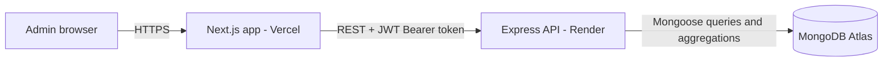
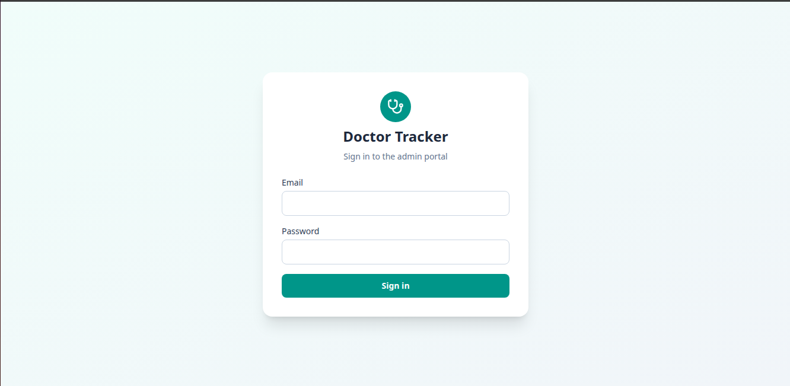
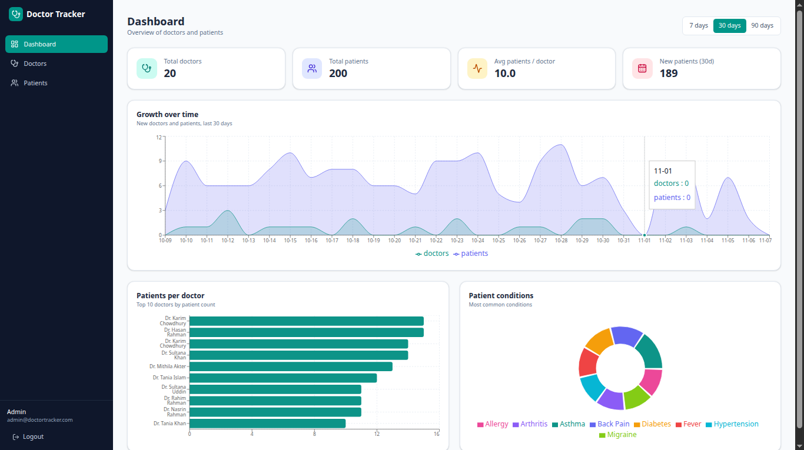
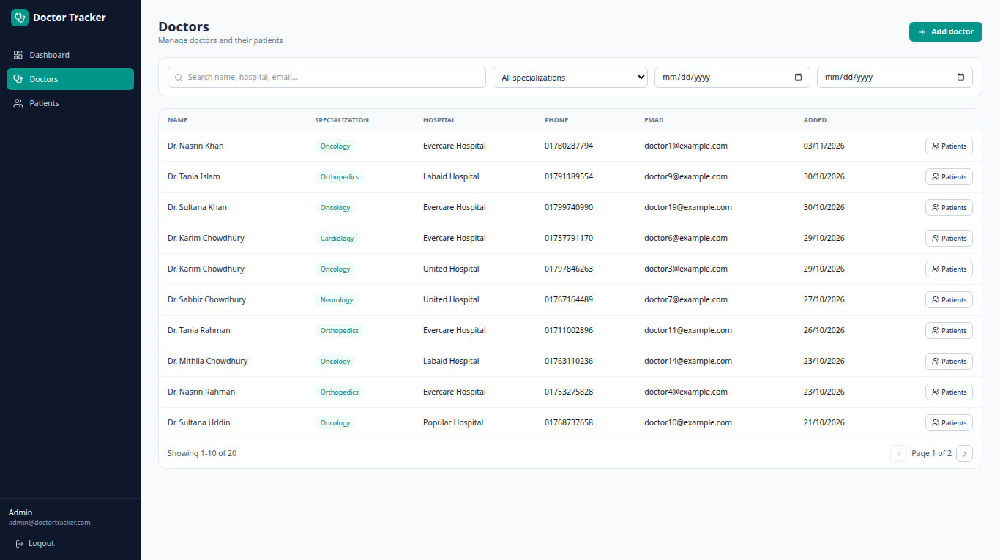
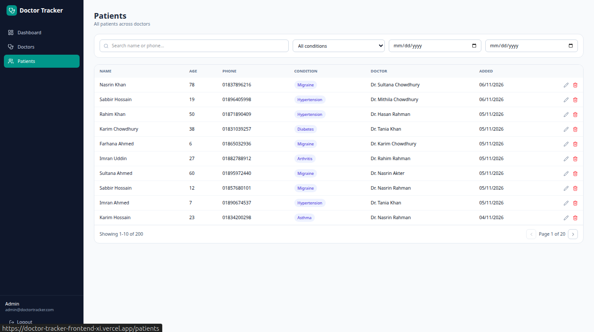
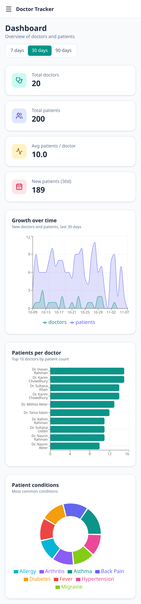
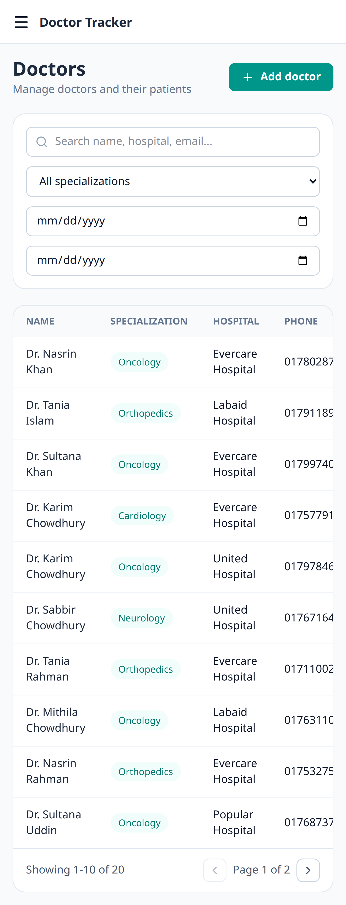

# Doctor Tracker - Frontend

**Doctor Tracker** is a secure admin portal for managing doctors and their patients. Authenticated admins can add doctors, attach patients to them, search, filter and paginate large datasets, and monitor the system through a dashboard with charts built on server-side MongoDB aggregations. This repository is the Next.js client; it talks to a separate Express REST API.

- **Live app:** https://doctor-tracker-frontend-xi.vercel.app
- **Live API:** https://doctor-tracker-backend-gly8.onrender.com/api
- **Backend repo:** https://github.com/abmmejbha/doctor-tracker-backend
- **Demo login:** `admin@doctortracker.com` / `Admin@123`

> The API runs on Render's free tier. After 15 minutes idle the first request can take 30-50 seconds while the server wakes up.

## Tech Stack

Next.js (App Router) · React · Tailwind CSS · TanStack Query · Axios · Recharts · Lucide icons

## Setup Guide

1. Clone and install:
   ```bash
   git clone https://github.com/abmmejbha/doctor-tracker-frontend.git
   cd doctor-tracker-frontend
   npm install
   ```
2. Create your env file from the example:
   ```bash
   cp .env.example .env.local
   ```
   | Variable | Description |
   |---|---|
   | `NEXT_PUBLIC_API_URL` | Base URL of the backend API, e.g. `http://localhost:5000/api` |
3. Start the backend first (see the backend README), then:
   ```bash
   npm run dev
   ```
4. Open http://localhost:3000 and sign in with the demo login above.

## System Architecture



**Data flow**
1. The admin logs in; the API returns a JWT which the client stores and an Axios interceptor attaches to every request.
2. Pages under `(app)/` are guarded by a layout that checks the session via `/auth/me` and redirects to `/login` when it fails.
3. Lists (doctors, patients) send `search`, `filter`, `from/to` and `page` params; the API filters and paginates in MongoDB and returns one page plus pagination metadata.
4. The dashboard calls a single `/dashboard/stats` endpoint; all totals and groupings are computed by MongoDB aggregation pipelines, not in the browser.
5. Mutations (add doctor, add/edit/delete patient) invalidate the affected TanStack Query caches so every screen refreshes automatically.

```
src/
  app/            routes: /login, (app)/dashboard, (app)/doctors, (app)/patients
  components/     Sidebar, Modal, Pagination, forms, chart/stat cards
  context/        AuthContext (session state)
  hooks/          useDebounce
  lib/            axios instance, shared UI classes
```

## Technical Decisions

### 1. TanStack Query + React Context instead of Redux
Nearly all state in this app is **server state** (doctors, patients, stats), not client state. TanStack Query handles caching, loading/error states, request de-duplication and cache invalidation out of the box, so there are no reducers, actions or manual loading flags. `keepPreviousData` keeps the old page visible while the next page loads, so pagination and filtering never flash empty. The only true client state is the logged-in user, which is small enough for a single React Context. Redux would have added a store, slices and boilerplate with no benefit here; the trade-off is that TanStack Query is not meant for complex client-only state, which this app does not have.

### 2. Server-side search, filtering and pagination backed by MongoDB indexes
The client never downloads the full dataset. Every list request sends its filters to the API, which uses `skip/limit` and returns a page plus a total count (fetched in parallel with `Promise.all`). Search input is debounced (400 ms) to avoid a request per keystroke, and the page resets to 1 whenever a filter changes. On the database side, compound indexes (`doctor + createdAt`, `specialization + createdAt`, `condition + createdAt`) match the filter-then-sort query patterns. Patients store a reference to their doctor rather than the doctor storing a patient array, so documents stay small as data grows. The trade-off is that regex search on names is not index-optimal at very large scale; a MongoDB text/Atlas Search index would be the next step.

## Visual Evidence

| Login | Dashboard (desktop) |
|---|---|
|  |  |

| Doctors (desktop) | Patients (desktop) |
|---|---|
|  |  |

| Dashboard (mobile) | Doctors (mobile) |
|---|---|
|  |  |

## Known Limitations
- The JWT is stored in `localStorage` for simplicity; an httpOnly cookie would be safer against XSS in production.
- Free-tier hosting causes a cold start after inactivity.